<p align="center">
  
</p>

<p align="center">
  <a href="https://github.com/Igorrochalord/Esteio/releases/latest"></a>
  <a href="https://github.com/Igorrochalord/Esteio/actions/workflows/ci.yml"></a>
  
  
</p>

## Para que serve

O **Núcleo ERP** é um sistema de gestão para pequenas e médias empresas, como padarias, lojas,
assistências técnicas e prestadores de serviço. Ele organiza vendas, estoque, clientes,
dinheiro e serviços num só lugar.

A ideia é ser **simples de ter**. Você não precisa de servidor nem de mensalidade de nuvem,
e ele funciona sem internet. Basta instalar no computador da empresa, como qualquer outro
programa. Os dados ficam guardados ali mesmo, com cópia de segurança automática, e o
sistema usa as cores e o logo da sua empresa.

<p align="center">
  
</p>

## Baixar

Escolha **um** arquivo, de acordo com o seu computador. O download começa na hora e sempre
traz a versão mais recente.

<p align="center">
  <a href="https://github.com/Igorrochalord/Esteio/releases/latest/download/NucleoERP-Windows-Instalador.exe"></a>
  &nbsp;
  <a href="https://github.com/Igorrochalord/Esteio/releases/latest/download/NucleoERP-Linux.AppImage"></a>
  &nbsp;
  <a href="https://github.com/Igorrochalord/Esteio/releases/latest/download/NucleoERP-Linux.deb"></a>
</p>

| Você usa… | Baixe | O que é |
|---|---|---|
| **Windows 10 ou 11** | [`NucleoERP-Windows-Instalador.exe`](https://github.com/Igorrochalord/Esteio/releases/latest/download/NucleoERP-Windows-Instalador.exe) | instalador comum: abrir, avançar, concluir |
| **Linux** (qualquer distribuição) | [`NucleoERP-Linux.AppImage`](https://github.com/Igorrochalord/Esteio/releases/latest/download/NucleoERP-Linux.AppImage) | programa num arquivo só; não precisa instalar |
| **Ubuntu, Debian, Mint** | [`NucleoERP-Linux.deb`](https://github.com/Igorrochalord/Esteio/releases/latest/download/NucleoERP-Linux.deb) | instala e aparece no menu de aplicativos |
| **Fedora, openSUSE** | [`NucleoERP-Linux.rpm`](https://github.com/Igorrochalord/Esteio/releases/latest/download/NucleoERP-Linux.rpm) | instala e aparece no menu de aplicativos |
| TI de empresa (Windows) | [`NucleoERP-Windows.msi`](https://github.com/Igorrochalord/Esteio/releases/latest/download/NucleoERP-Windows.msi) | instalação em massa / GPO |

> **Não sabe qual escolher?** No Windows, o `.exe`. No Linux, o `.AppImage`.
> Passo a passo de instalação, aviso do Windows na primeira vez e como atualizar sem perder
> dados estão em **[docs/executar.md](docs/executar.md)**.
> Todas as versões: [Releases](https://github.com/Igorrochalord/Esteio/releases).

## O que tem dentro

| Módulo | Faz |
|---|---|
| **Vendas** | venda à vista ou fiado, cancelamento, entra direto no financeiro |
| **Estoque** | produtos, categorias, entradas e saídas, alerta de estoque mínimo |
| **Clientes** | cadastro completo, importar e exportar Excel, mapa por estado |
| **Financeiro** | contas a pagar e a receber, contas bancárias, extrato (OFX), fluxo de caixa, DRE |
| **Ordens de serviço** | quadro de etapas, peças e serviços, prazos, faturar com um clique, imprimir OS |
| **Relatórios** | painel inicial, curva ABC, vendedores, comparar períodos, Excel e PDF |
| **Pessoas e segurança** | usuários com papéis (dono, administrador, usuário), histórico de alterações |
| **Cópias de segurança** | automáticas, mais cópia manual e restauração |

Tudo com modo claro e escuro, grades tipo planilha e um tutorial guiado na primeira vez.

## Como é feito

| Parte | Tecnologia |
|---|---|
| Interface | React 19 + TypeScript + Vite, dentro do Tauri v2 |
| Regras de negócio | Rust (`crates/nucleo-core`) |
| Dados | SQLite local (sqlx), com backup automático |
| Instaladores | Tauri bundler, gerados no CI: `.exe`/`.msi` (Windows), `.AppImage`/`.deb`/`.rpm` (Linux) |

```
apps/desktop/            app instalável
  src/                   interface React (pages, components, layouts, services, hooks)
  src-tauri/             casca Tauri: comandos finos que chamam o núcleo
crates/nucleo-core/      regras de negócio + banco (sem interface)
docs/                    documentação por tópico + decisões (adr/)
.github/workflows/       CI: lint, testes e instaladores Windows e Linux
```

## Documentação

**Como executar, instalar, atualizar e publicar:** [docs/executar.md](docs/executar.md).

**Documentação Master em PDF:** [docs/Nucleo-ERP-Documentacao.pdf](docs/Nucleo-ERP-Documentacao.pdf), com o projeto inteiro,
arquivo por arquivo, e onde alterar cada coisa (fonte: `docs/manual/manual.html`; regenerar com `make manual`).

| Tópico | Conteúdo |
|---|---|
| [Executar e atualizar](docs/executar.md) | baixar, instalar, atualizar, rodar o código, publicar versão |
| [Estrutura de pastas](docs/estrutura.md) | o que cada pasta e arquivo principal faz |
| [Arquitetura](docs/arquitetura.md) | camadas, caminho de uma ação da tela ao banco, módulos |
| [Desenvolvimento](docs/desenvolvimento.md) | ambiente, comandos, testes, como criar um módulo |
| [Banco de dados](docs/banco-de-dados.md) | SQLite, migrações, regras de tabela, sync, auditoria |
| [Segurança e permissões](docs/seguranca-e-permissoes.md) | login, sessão, papéis, CSP |
| [Backup e restauração](docs/backup.md) | cópias automáticas e manuais, restauração |
| [Distribuição](docs/distribuicao.md) | instaladores, atalhos, CI e release no GitHub |
| [Assinatura](docs/assinatura.md) | pesquisa: modelos de plano, cobrança e licença offline |
| [Roteiro](docs/roteiro.md) | fases concluídas e próximas |
| [Decisões (ADR)](docs/adr/) | registro das decisões de arquitetura |
